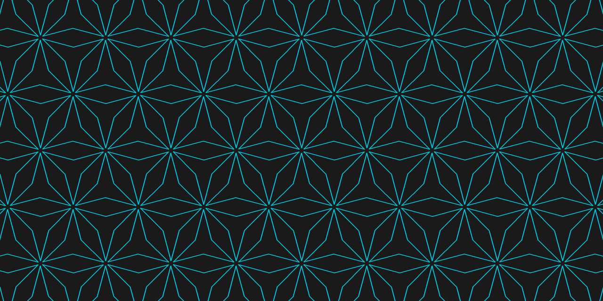

# Islamic Geometry



**Draw Islamic star patterns in the browser and download them as SVG.**

A small web app that builds Islamic geometric patterns with the polygons-in-contact
method (often called Hankin's method). It lays down a hexagonal or square grid, and at
every tile corner it starts two lines from contact points on the neighboring edges and
crosses them at an angle you choose. Small changes to the two numbers turn the same grid into stars, rosettes
and interlaced bands.

## Use it

ES modules don't load from `file://`, so serve the folder and open it in a browser:

```sh
python3 -m http.server 8000
# then open http://localhost:8000
```

There is no build step and no dependencies. The only network request is the Outfit
font from Google Fonts.

## What it does

- **Grid type:** hexagonal (6-fold) or square (4-fold).
- **Tile count:** how many tiles span the canvas, from 2 to 36.
- **Contact point:** where on each tile edge the lines start, from the corner (0%) to
  the midpoint (50%).
- **Crossing angle:** the angle of the pattern lines against the tile edge, 15° to 89°.
- **Show construction:** draws the underlying grid under the pattern, in its own color.
- **Pattern color:** the stroke color for the pattern lines.
- **Edit tile motif:** opens one tile at full size. Click a segment to hide or show it;
  right-click to cycle its color. Apply, and every tile in the pattern follows.
- **Download SVG:** saves the pattern as `islamic-pattern-<grid>.svg`, one `<line>` per
  segment, ready for Figma, Illustrator or a plotter.

## How it works

- `js/geometry.js`: the grid (hexagonal or square polygons) and the tile motif. At
  each corner of a tile it places contact points on the two edges, casts a ray from each
  at the crossing angle, and keeps the V where they meet. Segments are then split where
  they cross, so each piece can be hidden or recolored, and the motif is stamped onto
  every tile.
- `js/renderer.js`: draws to the canvas and writes the SVG export.
- `js/editor.js`: the single-tile motif editor and its hit testing.
- `js/main.js`: wires the controls to the geometry and redraws on every change.

## License

MIT; see [LICENSE](LICENSE).
